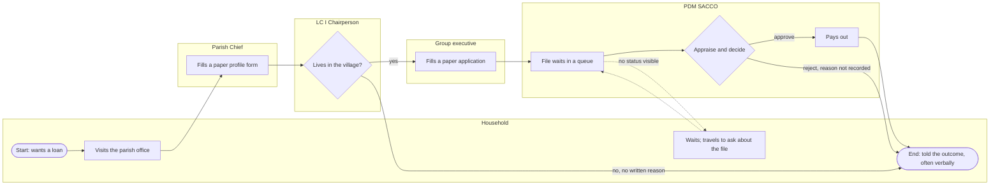
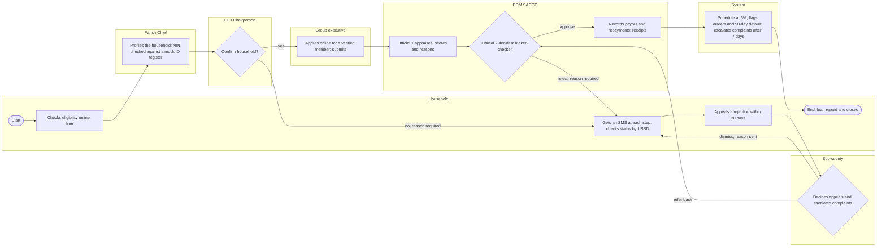
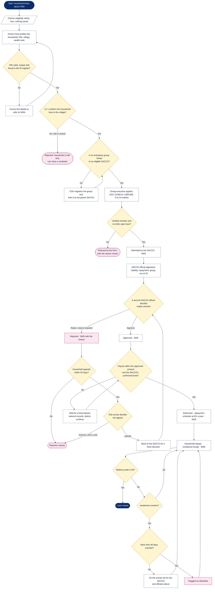

# 2. Current and proposed process

*Phase 1 · Process modelling (8 marks)* · **Owner:** Kaitesi Lillian · **Reviewed by:** Balirwa Alvin Daniel, Ssuubi Stephen, Okello Emmanuel (sign when checked)

Flowcharts with swimlanes (one lane per role). They render on GitHub; for the report, redraw them in a BPMN 2.0 tool (for example draw.io or Camunda Modeler) if the assessor prefers BPMN notation.

## 2.1 Current process (paper based, as described in the guidelines and to be confirmed by interviews)

**Exceptions:** files lost or incomplete; household cannot be reached; a complaint is raised verbally with no record; a refusal cannot be appealed because no reason was written.

### Measurable bottleneck

| Measure | Current (baseline) | How it is measured |
| --- | --- | --- |
| **Time from submission to SACCO decision** | Estimated **3 to 6 weeks** **[assumption: confirm in interviews]** | Days between application date and decision date in SACCO files |
| Household trips to ask about status | Estimated **2 to 4 per application** **[assumption]** | Interviews with households |
| Refusals with a written reason | Estimated **under 50%** **[assumption]** | Sample of SACCO files |
| Complaints with a reference and an answer | Not recorded **[assumption]** | Parish complaint books |

The bottleneck is **the SACCO queue (F) combined with no visible status**: files wait without anyone above knowing, and households must travel to find out.

## 2.2 Proposed process (the prototype)

## 2.3 What changes

| Problem in the current process | Change in the proposed process | Feature |
| --- | --- | --- |
| No visible status | Status on the web, by USSD and by SMS at each step | My household, USSD, SMS alerts |
| Refusals without reasons | A reason is required for every rejection | Decision form, LC I verification |
| One person appraises and decides | Maker-checker: a second official decides | Workflow rule |
| No way to challenge a refusal | Appeal to the sub-county within 30 days | Appeals |
| Complaints lost | Reference numbers; escalation after 7 days; bribery reports skip the parish | Complaints |
| Late paper reports | Live dashboards and quarterly reports | Dashboard, Reports |

**Target:** submission-to-decision time **under 7 days**, with every refusal carrying a reason (see section 3).

## 2.4 System flowchart: one application from start to finish

Standard flowchart symbols: rounded ends are start and finish points, diamonds are decisions, and pink boxes are refusals or problems. Every rule shown is enforced by the prototype (for example, a rejection needs a reason, the official who appraises cannot decide, and a payout cannot exceed the SACCO's confirmed funds). Image: [diagrams/D6-system-flowchart.png](diagrams/D6-system-flowchart.png).

