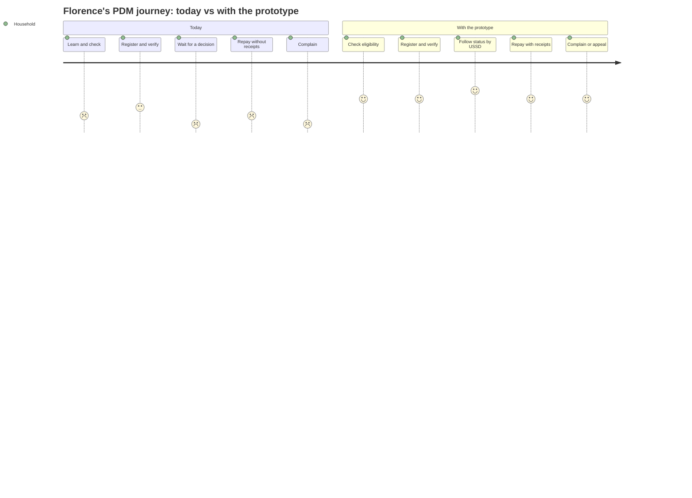

# 4. Household journey map

*Phase 2 · Journey (8 marks)* · **Owner:** ______________ · **Reviewed by:** ______________

The journey of one household (persona: Florence, section 6) from first hearing about PDM to repaying the loan. Each stage shows what she does, where (touchpoint), what goes wrong today, the exceptions, and how the prototype improves it.

| Stage | Household action | Touchpoints | Pain points today | Exceptions | Improvement in the prototype |
| --- | --- | --- | --- | --- | --- |
| **0. Learn and check** | Hears about PDM; wonders if she qualifies | Radio, LC I, neighbours | Rumours about who qualifies; some pay "facilitators" | Not in the target group | Public **Am I eligible?** page and USSD; *PDM services are free* on every screen |
| **1. Register** | Gives her details and NIN to the Parish Chief | Parish office | Long queues; forms re-filled | Duplicate or wrong NIN | NIN format and uniqueness checks; **mock ID register** check; one register |
| **2. Verify** | Waits for the LC I to confirm she lives in the village | LC I | No idea whether it was done | LC I rejects her | LC I confirms in two clicks; **a rejection needs a reason**, which she sees |
| **3. Group** | Joins an enterprise group | Group meeting, CDO | Group not linked to a SACCO, so no loan | No SACCO in the parish | Groups are linked to the parish SACCO automatically; her checklist shows what is missing |
| **4. Apply** | The group executive applies with her | Group executive | Paper application lost | Already has an open loan; over the ceiling | Online application with checks (verified, UGX 1M ceiling, one open loan) |
| **5. Appraise** | Waits | SACCO | File waits for weeks; no status | Incomplete plan | Scores and reasons recorded; status visible to her |
| **6. Decide and pay out** | Receives the decision and money | SACCO, mobile money | Refusals without reasons; one official decides alone | Rejected; not enough funds | **Maker-checker**; reason required; SMS on approval and payout |
| **7. Repay** | Pays monthly | SACCO, mobile money | No receipt; balance unclear | Falls behind; default | Schedule at 6%; **numbered receipts**; arrears and default flagged |
| **8. Check** | Asks "where is my loan?" | Phone | Travels to the office to ask | No smartphone | **USSD** in English or Luganda; her own web page |
| **9. Speak up** | Complains or appeals | Parish office | Complaint lost; asked for a bribe | Bribery by a parish official | Reference numbers; escalation after 7 days; bribery goes straight to the sub-county; **appeal** to the sub-county |
| **10. Oversight** | (Officials) | Dashboards | Late paper reports | Data errors | Live dashboards, audit trail, public parish figures |

## Emotional curve (for the slides)

