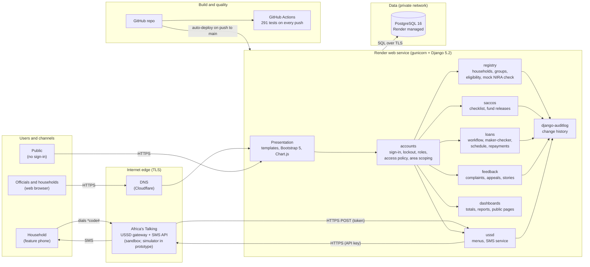

# 9. System architecture

*Phase 4 · Architecture (4 marks)* · **Owner:** Ogenrwot Churchill · **Reviewed by:** Balirwa Alvin Daniel, Ssuubi Stephen, Okello Emmanuel (sign when checked)

## 9.1 Diagram

## 9.2 Layers

| Layer | What it holds | Technology |
| --- | --- | --- |
| Channels | Web for officials and households with smartphones; USSD and SMS for feature phones; public pages with no sign-in | Browser, Africa's Talking (simulated in the prototype) |
| Presentation | Server-rendered pages; one menu built from the access policy | Django templates, Bootstrap 5.3, Chart.js 4 |
| Application | Seven Django apps; all loan status changes go through one workflow function | Python 3.12, Django 5.2 |
| Integration | Africa's Talking USSD/SMS; mock national ID register (stand-in for NIRA) | HTTPS, REST |
| Data | One relational database; audit log in the same database | PostgreSQL 16 |
| Hosting and delivery | Render free web service and database; GitHub Actions CI; Cloudflare DNS | Render Blueprint (`render.yaml`) |

## 9.3 Trust boundaries

1. **Internet → web app.** Everything over HTTPS (HSTS on). Sign-in required for all but the public pages; CSRF tokens on every form.
2. **USSD gateway → app.** The callback is CSRF-exempt, so it checks a shared token (`USSD_CALLBACK_TOKEN`) and only answers for a phone number that is registered.
3. **App → database.** Credentials only in environment variables on Render; the database is not exposed publicly.
4. **Inside the app.** Role check (access policy) and area check (scoping) on every view; the auditor is read-only.

## 9.4 Deployment assumptions

- Free tier: the service sleeps when idle (first request ~50 s); a GitHub Actions job pings it to keep it awake during the presentation week.
- A real deployment would run in a government data centre (e.g. NITA-U) **[verify]**, with a paid database with backups, and a real USSD short code.
