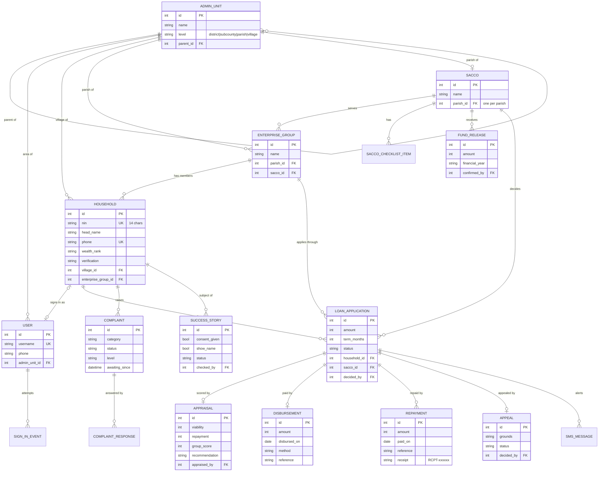

# 10. Data design

*Phase 4 · Data design (4 marks)* · **Owner:** ______________ · **Reviewed by:** ______________

## 10.1 Entity relationship diagram

Every table also has an **audit log** (django-auditlog): who changed which field, from what, to what, and when.

## 10.2 Identifiers

| Entity | Identifier shown to people |
| --- | --- |
| Household | National ID number (NIN), unique |
| Complaint | `PDM-000123` (digits only, easy on a keypad) |
| Appeal | `APL-000123` |
| Repayment receipt | `RCPT-000123` |
| Disbursement | Mobile money or bank reference |

## 10.3 Validation rules

| Field | Rule | Where enforced |
| --- | --- | --- |
| NIN | 14 letters or digits, stored in capitals, unique | Model validator + database unique constraint |
| Phone | Uganda format, unique per household | Form + database |
| Loan amount | UGX 10,000 to 1,000,000 | Form + model |
| Term | 3–24 months | Form |
| One open loan | A household may have only one loan not yet closed | Form |
| Verification | Rejection needs a note | Form + view |
| Decision | Rejection needs a reason; appraiser cannot decide | `workflow.move()` |
| Disbursement | Not above approved amount or SACCO's confirmed funds | Form |
| Appeal | Within 30 days of rejection; grounds of at least 10 characters; decision note required | `feedback/appeals.py` |
| Story | Consent recorded before PDC check | Form + view |

## 10.4 Retention and data minimisation

- **Collected only what PDM needs:** no photos, no exact GPS, no bank account details, no income figures; age as a band, not a date of birth.
- **Public pages** show only totals; stories show the first name and village unless the household agreed to be named.
- **Records are never deleted** by users (`on_delete=PROTECT` on loans and households) so the audit trail stays complete.
- **Retention (proposal for a real system):** loan records 7 years after closure, complaints 3 years, sign-in log 1 year **[verify against the Data Protection and Privacy Act 2019 and PFMA rules]**.
- **Prototype:** all data is fictitious and can be wiped and reloaded with *Reset demo data*.
